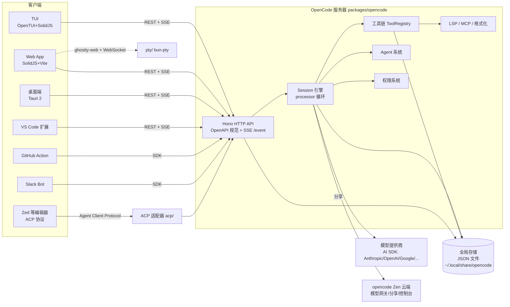
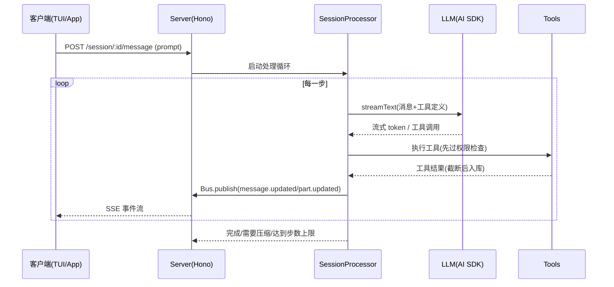

# 02 整体架构

## 1. 架构总览



核心思想：**服务器是唯一事实源**。所有客户端（包括 TUI）都只是 API + 事件流的消费者，客户端类型由 OpenAPI 规范生成的 `@opencode-ai/sdk` 统一提供。

## 2. 客户端 / 服务器模型

| 启动方式 | 行为 |
| --- | --- |
| `opencode`（无参数） | 在 worker 线程启动本地服务器（默认 `http://localhost:4096`）+ 拉起 TUI（`cli/cmd/tui/worker.ts`） |
| `opencode serve` | 仅启动无头服务器（[serve.ts](../packages/opencode/src/cli/cmd/serve.ts) → `Server.listen()`） |
| `opencode web` | 启动服务器并打开 Web 界面 |
| `opencode attach <url>` | TUI 远程接入已有服务器，支持 `--dir/--session/--password`（Basic Auth），见 [attach.ts](../packages/opencode/src/cli/cmd/tui/attach.ts) |
| `opencode acp` | 以 ACP（Agent Client Protocol）模式供编辑器（如 Zed）驱动 |

服务器支持：可选 Basic Auth（`OPENCODE_SERVER_PASSWORD/USERNAME`）、CORS 白名单（localhost、`tauri://`、`*.opencode.ai`）、mDNS 局域网发现（bonjour-service）、SSE 事件流与 WebSocket（PTY）。

## 3. 请求与事件流

内部事件总线 [bus/index.ts](../packages/opencode/src/bus/index.ts)：

- `BusEvent.define(type, zodSchema)` 声明事件类型（如 `installation.updated`、`server.instance.disposed`）。
- `Bus.publish(def, properties)` → 分发给本实例订阅者（含 `*` 通配）→ 同时 `GlobalBus.emit` 跨实例广播。
- 服务器的 `/event` 端点把事件以 **SSE** 推给所有客户端；SDK 内置 SSE 解析（`serverSentEvents.gen.ts`）。



## 4. Project / Instance / Worktree 模型

- **Project**（[project/project.ts](../packages/opencode/src/project/project.ts)）：以 git 根为边界识别项目，项目 ID 取自仓库首个根提交（`git rev-list --max-parents=0`），非 git 目录归入 `global` 项目。
- **Instance**（[project/instance.ts](../packages/opencode/src/project/instance.ts)）：一次服务器会话中针对某个目录的运行上下文（`directory` / `worktree`）。提供全仓库最核心的模式 `Instance.state(async () => {...}, dispose?)`：**按目录缓存的惰性单例状态**，`Config`、`Agent`、`ToolRegistry`、`Bus` 等全部用它管理自身状态；实例销毁时触发 dispose 并发布 `server.instance.disposed`。
- **VCS**（[project/vcs.ts](../packages/opencode/src/project/vcs.ts)）：git 集成（分支、worktree 信息）。
- **Bootstrap**（[project/bootstrap.ts](../packages/opencode/src/project/bootstrap.ts)）：实例启动时初始化 LSP、文件监听等。

## 5. 持久化：Storage

[storage/storage.ts](../packages/opencode/src/storage/storage.ts) 是无数据库的 JSON 文件存储，位于 XDG 全局目录（[global/index.ts](../packages/opencode/src/global/index.ts)）：

| 全局路径 | 用途 |
| --- | --- |
| `~/.local/share/opencode`（data） | 项目、会话、消息、认证凭据、二进制 |
| `~/.config/opencode` | 全局配置、agent/skill/command 定义 |
| `~/.local/state/opencode`、`~/.cache/opencode` | 状态与缓存（缓存按 `CACHE_VERSION` 失效重建） |
| `~/.local/share/opencode/log` | 日志文件 |

存储布局（含自动迁移，`MIGRATIONS` 数组）：

```
data/
├── project/<projectID>.json
├── session/<projectID>/<sessionID>.json
├── message/<sessionID>/<messageID>.json
├── part/<messageID>/<partID>.json        # 消息分片(文本/工具调用/推理…)
└── auth.json 等凭据
```

写入通过 `Lock`（文件锁）与去抖处理保证并发安全；读取失败抛 `Storage.NotFoundError`（服务器映射为 404）。

## 6. 配置系统（Config）

[config/config.ts](../packages/opencode/src/config/config.ts) 按以下优先级（低 → 高）深合并（数组字段拼接去重，支持 JSONC）：

1. 远程 `.well-known/opencode`（组织级默认）
2. 全局配置 `~/.config/opencode/opencode.json{,c}`
3. `OPENCODE_CONFIG` 指定的自定义文件
4. 项目配置 `opencode.json{,c}`（findUp 至 worktree，可 `OPENCODE_DISABLE_PROJECT_CONFIG` 关闭）
5. `.opencode/` 目录（`agents/`、`commands/`、`plugins/`、`tool/`、`opencode.json{,c}`）
6. `OPENCODE_CONFIG_CONTENT` 内联配置
7. 企业托管配置目录（最高，管理员控制）：`/etc/opencode`、`/Library/Application Support/opencode`、`%ProgramData%/opencode`

配置可声明：模型/提供商、`agent`（含权限、prompt）、`mcp` 服务器、`plugin`、`instructions`、`permission`、`keybinds`、`formatter`、`lsp`、`experimental` 开关等。

## 7. 权限系统（Permission）

[permission/next.ts](../packages/opencode/src/permission/next.ts) 实现规则集（Ruleset）模型：

- 每个工具一个规则：`"allow" | "ask" | "deny"` 或按路径通配的对象（如 `read: { "*.env": "ask", "*": "allow" }`）。
- `PermissionNext.fromConfig()` 把用户配置转规则集，`merge()` 按内置默认 → agent 默认 → 用户配置叠加。
- 内置默认示例：`*` allow、`doom_loop` ask、外部目录 ask、`question/plan_enter/plan_exit` 按场景控制、`.env` 类文件读取需确认。
- `ask` 时通过 `Question`/`Permission` 路由把请求推给客户端 UI（TUI 弹窗 / App 对话框），也可被插件 `permission.ask` hook 拦截。

## 8. 会话引擎（Session Engine）

会话引擎位于 [session/](../packages/opencode/src/session/)，是产品核心：

- **Session.Info**：会话元数据（id、projectID、directory、parentID 支持子会话、revert 指针、share.url、时间戳等）。
- **SessionPrompt**（prompt.ts）：对外入口 —— 接收用户 prompt/命令，创建消息，驱动处理器。
- **SessionProcessor**（processor.ts）：`while(true)` 主循环 —— 每轮调用 `LLM.stream()`（[llm.ts](../packages/opencode/src/session/llm.ts) 封装 AI SDK `streamText`），处理流式输出、工具调用、权限，直到模型不再调用工具或触发终止条件。
- **MessageV2 / message.ts**：消息与分片（part）模型（文本、tool 调用、reasoning、文件快照等）。
- **Compaction**（compaction.ts）：当 token 用量逼近模型上下文窗口（比例阈值 + `compaction.auto`）时自动总结压缩历史，注入 compaction prompt 继续。
- **Revert**（revert.ts）+ **Snapshot**（snapshot/index.ts，git 快照）：消息级撤销，把代码回滚到某条消息之前。
- **SystemPrompt**（system.ts）：按提供商拼装系统提示（`session/prompt/*.txt`：anthropic、codex、gemini、qwen、beast、copilot-gpt-5 等），并叠加 AGENTS.md/rules、LSP 状态、todo 等。
- **Retry / Status / Summary / Todo**：重试退避、会话状态事件、标题与摘要生成（`agent/prompt/title.txt` 等）、任务清单工具支撑。

## 9. 模型接入（Provider）

- [provider/models.ts](../packages/opencode/src/provider/models.ts)：拉取 **models.dev** 目录作为模型元数据（上下文长度、价格、能力），本地缓存。
- [provider/provider.ts](../packages/opencode/src/provider/provider.ts)：`providerID → @ai-sdk/*` 工厂映射，覆盖 Anthropic、OpenAI、Azure、Bedrock、Google(+Vertex)、Groq、Mistral、Cohere、Cerebras、Perplexity、xAI、DeepInfra、Together、Vercel Gateway、OpenRouter、GitLab、ai-gateway-provider 等；`opencode` 提供商即官方 **Zen 网关**（见 [06-cloud-console.md](06-cloud-console.md)）。
- [provider/auth.ts](../packages/opencode/src/provider/auth.ts)：凭据管理（`opencode auth login`，OAuth 或 API key，落盘 `auth.json`）。
- [provider/transform.ts](../packages/opencode/src/provider/transform.ts)：按提供商做请求变换（如缓存标记、参数修正）。
- `provider/sdk/copilot/`：内置的 GitHub Copilot 定制 SDK（chat / responses 协议适配）。

## 10. 扩展机制一览

| 机制 | 说明 | 详见 |
| --- | --- | --- |
| 插件 Plugin | npm 包或本地文件，hook 进 chat/permission/tool 生命周期；内置 codex、copilot 认证插件 | [05-clients.md](05-clients.md) |
| 自定义工具 | `.opencode/tool/*.{js,ts}` 或插件 `tool` 导出，与内置工具同权 | 03 |
| 自定义 Agent | `.opencode/agent/*.md`（frontmatter 定义模型/权限/prompt） | 03 |
| Skill | SKILL.md 目录发现，`skill` 工具按需加载 | 03 |
| 自定义命令 | markdown 模板（template/initialize.txt 等）注册为会话命令 | 03 |
| MCP | 远程/本地 MCP 服务器接入为工具，支持 OAuth | 03 |
| 主题 | TUI JSON 主题 / 桌面端可配置主题 schema | 04/05 |
