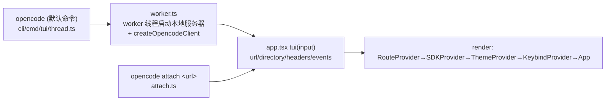

# 04 终端界面（TUI）

TUI 代码位于 [packages/opencode/src/cli/cmd/tui/](../packages/opencode/src/cli/cmd/tui/)，随核心包一同发布，不是独立 workspace。

## 1. 技术选型

- **OpenTUI**：`@opentui/core` + `@opentui/solid`（SST 自研的终端渲染框架，用 **SolidJS** 组件模型直接渲染到终端）。
- 周边库：`solid-js`、`@solid-primitives/event-bus`、`@solid-primitives/scheduled`、`opentui-spinner`。
- 与服务器通信完全走 `@opencode-ai/sdk`（v2 client）+ SSE —— **TUI 与 Web 客户端在架构上完全对等**。

## 2. 启动链路

- [thread.ts](../packages/opencode/src/cli/cmd/tui/thread.ts)：`TuiThreadCommand`，默认入口，负责 worker 生命周期。
- [worker.ts](../packages/opencode/src/cli/cmd/tui/worker.ts)：worker 线程内启动服务器，包装本地 `fetch` 并创建 SDK client，桥接事件。
- [attach.ts](../packages/opencode/src/cli/cmd/tui/attach.ts)：远程接入（URL + 可选 BasicAuth）。
- [app.tsx](../packages/opencode/src/cli/cmd/tui/app.tsx)：`tui()` 接收 `{ url, directory, fetch, headers, events }`，组装 Provider 树并 `render()`。

## 3. Context（Provider 体系）

位于 [tui/context/](../packages/opencode/src/cli/cmd/tui/context/)：

| Context | 文件 | 职责 |
| --- | --- | --- |
| Route | route.tsx | 页面路由：`home` / `session` 两类路由，`navigate()` + `useRouteData()` |
| SDK | sdk.tsx | 创建 SDK client；事件订阅（外部 EventSource 或 `event.subscribe`）批量转发到 Solid event bus |
| Theme | theme.tsx | 主题系统：加载 `context/theme/*.json`（30+ 内置主题：catppuccin、gruvbox、tokyonight、dracula…），`resolveTheme` 按 dark/light 解析为 RGBA |
| Keybind | keybind.tsx | 键位系统：读取 `config.keybinds`，`Keybind.match` 匹配按键，支持 leader key |
| Local / Sync | local.tsx / sync.tsx | 本地状态与服务器数据同步（对应 App 包的同名机制） |
| Args / Directory / KV / Prompt / Exit / Helper | args.tsx 等 | 启动参数、目录、键值存储、prompt 上下文等 |

## 4. 路由与界面

- **routes/home.tsx**：项目/会话列表首页。
- **routes/session/**：会话主界面 ——
  - `index.tsx` 布局，`header.tsx` / `footer.tsx`；
  - `permission.tsx`（权限请求卡片）、`question.tsx`（问答）；
  - `sidebar.tsx`（会话信息/改动统计）；
  - `dialog-timeline.tsx`（消息时间线）、`dialog-fork-from-timeline.tsx`（从历史分叉）、`dialog-message.tsx`、`dialog-subagent.tsx`（子代理查看）。

## 5. 组件

- **prompt/**（[component/prompt/](../packages/opencode/src/cli/cmd/tui/component/prompt/)）：输入框核心 —— `index.tsx`、`autocomplete.tsx`（@文件/@agent/@命令 补全）、`history.tsx` + `frecency.tsx`（历史与频次排序）、`stash.tsx`（暂存草稿）。
- **dialog-\***：模型选择（dialog-model）、提供商（dialog-provider）、MCP、技能（dialog-skill）、会话列表/重命名、主题列表、标签、状态面板等。
- **ui/**：通用件 —— dialog-alert/confirm/prompt/select、toast、spinner、link、help、export-options。
- **util/**：`transcript.ts`（导出会话为 markdown transcript）、`clipboard.ts`、`editor.ts`（`$EDITOR` 打开外部编辑）、`terminal.ts`、`signal.ts`。

## 6. 主题

内置主题 JSON 位于 [tui/context/theme/](../packages/opencode/src/cli/cmd/tui/context/theme/)（ayu、aura、cobalt2、flexoki、kanagawa、nord、one-dark、rosepine、solarized、vesper、zenburn 等）。用户可通过配置自定义主题。根目录 `themes/undertale.json`、`themes/deltarune.json` 是彩蛋主题。

## 7. 交互要点

- `Tab` 在 build/plan agent 间切换；权限请求内联在会话流中审批。
- 所有数据变更（消息流、工具执行、权限、LSP 诊断）均来自 SSE 事件 → UI 是事件的纯函数投影，天然支持多客户端同会话。
